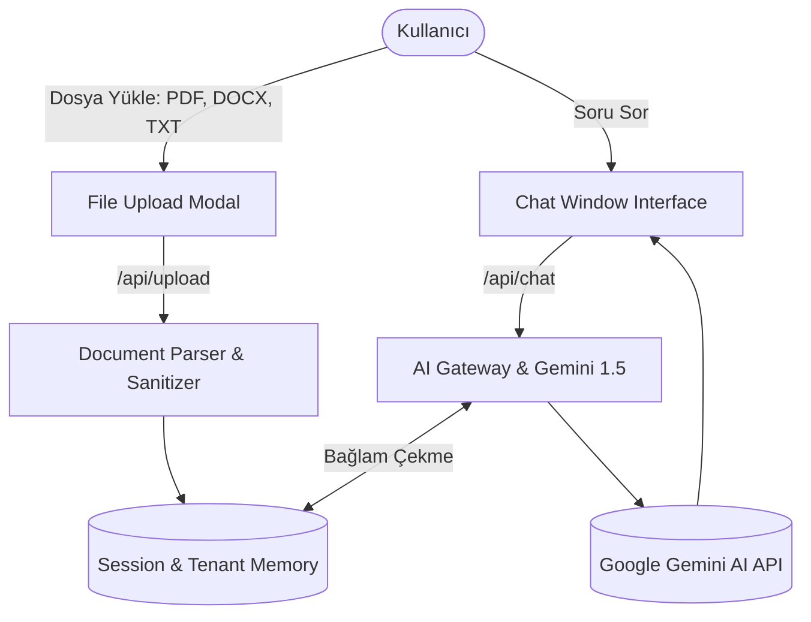

# 📄 Document Chat - Multi-Format AI Document Analysis & Q&A

[](https://www.typescriptlang.org/)
[](https://nextjs.org/)
[](https://reactjs.org/)
[](https://tailwindcss.com/)
[](https://deepmind.google/technologies/gemini/)
[](https://www.yucelgumus.dev/)

> PDF, DOCX, TXT, CSV ve diğer popüler dosya formatlarındaki dokümanları yükleyip anında analiz eden, akıllı metin ayrıştırma (parsing) ve **Google Gemini AI** motoru ile dokümanlar üzerinde derinlemesine soru-cevap yapan modern Next.js 15 web platformu.

---

## 🌟 Öne Çıkan Özellikler

- 📑 **Çoklu Doküman Formatı Desteği:** PDF, Word (DOCX), Düz Metin (TXT), CSV ve Markdown dosyalarını tek tıkla yükleyin ve ayrıştırın (`lib/document-parser.ts`).
- 💬 **Bağlamsal Soru-Cevap (Document Q&A):** Yüklenen belgelerin içeriğine sadık kalarak, kaynak bölümleri referans alan anlamsal yanıtlar üretir.
- 🗂️ **Doküman Yan Paneli & Yönetimi:** Aktif dokümanlar arasında geçiş yapma, dosya boyutu ve kelime sayısını görüntüleme, doküman silme ve durum kontrolü (`DocumentSidebar.tsx`).
- 🔒 **Güvenli Multi-Tenant Oturum Mimarisi:** Kullanıcı ve oturum bazlı doküman izolasyonu (`lib/tenant.ts`, `lib/gateway.ts`).
- 🎨 **Shadcn/UI & Tailwind Tasarım:** Modern kartlar, rozetler, yükleme modalları ve pürüzsüz sohbet akışı.

---

## 🏗️ Mimari & Sistem Akışı



| Bileşen / Katman | Açıklama |
| :--- | :--- |
| **`lib/document-parser.ts`** | Farklı dosya türlerini temiz metin parçacıklarına dönüştüren ayrıştırıcı |
| **`app/api/upload/route.ts`** | Dosya doğrulama, boyut limiti ve içerik yükleme endpoint'i |
| **`app/api/chat/route.ts`** | Doküman bağlamını Gemini 1.5 promptuna ekleyen sohbet API'si |
| **`components/custom/`** | `ChatWindow`, `DocumentSidebar`, `FileUploadModal`, `ChatMessage` UI |

---

## 🚀 Hızlı Başlangıç

### Gereksinimler
- **Node.js**: v18.18+ veya v20+
- **Google Gemini API Key**: [Google AI Studio](https://aistudio.google.com/)

### Kurulum

```bash
# Depoyu klonlayın
git clone https://github.com/yucel-gumus/document_chat.git
cd document_chat

# Bağımlılıkları yükleyin
npm install
```

### Ortam Değişkenleri (`.env.local`)

```env
GEMINI_API_KEY=your_gemini_api_key_here
```

### Uygulamayı Çalıştırma

```bash
# Geliştirme sunucusu
npm run dev
```

Uygulamaya tarayıcınızdan `http://localhost:3000` adresinden erişebilirsiniz.

---

## 📂 Proje Dizin Yapısı

```
document_chat/
├── package.json
├── components.json
├── tailwind.config.ts
├── next.config.ts
├── app/
│   ├── layout.tsx
│   ├── page.tsx
│   └── api/
│       ├── upload/route.ts         # Doküman yükleme ve ayrıştırma
│       ├── chat/route.ts           # Doküman içi AI sohbet API
│       ├── delete/route.ts         # Doküman kaldırma API
│       ├── check-data/route.ts     # Veri bütünlüğü kontrolü
│       └── session/route.ts        # Oturum yönetimi
├── components/
│   ├── custom/
│   │   ├── ChatWindow.tsx          # Ana sohbet penceresi
│   │   ├── ChatMessage.tsx         # Mesaj balonları ve kaynak kartları
│   │   ├── DocumentSidebar.tsx     # Yüklü belgeler yan menüsü
│   │   ├── FileUpload.tsx          # Dosya sürükle-bırak alanı
│   │   └── FileUploadModal.tsx     # Yükleme diyaloğu
│   └── ui/                         # Shadcn/ui bileşenleri
└── lib/
    ├── document-parser.ts          # PDF/DOCX/TXT/CSV ayrıştırıcı
    ├── tenant.ts                   # Çoklu kiracılık desteği
    ├── gateway.ts                  # Gemini API ağ geçidi
    └── types.ts                    # TypeScript tipleri
```

---

## 📄 Lisans
Bu proje [MIT Lisansı](LICENSE) ile lisanslanmıştır.

---

## 👨‍💻 Geliştirici & İletişim

**Yücel Gümüş** - Full Stack Developer

- 🌐 **Web Sitesi / Portfolyo:** [yucelgumus.dev](https://www.yucelgumus.dev/)
- 💼 **LinkedIn:** [linkedin.com/in/yucel-gumus](https://www.linkedin.com/in/yucel-gumus/)
- 🐙 **GitHub:** [@yucel-gumus](https://github.com/yucel-gumus)

<p align="left">
  <a href="https://www.yucelgumus.dev/" target="_blank" rel="noopener noreferrer">
    
  </a>
</p>